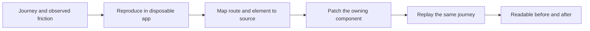
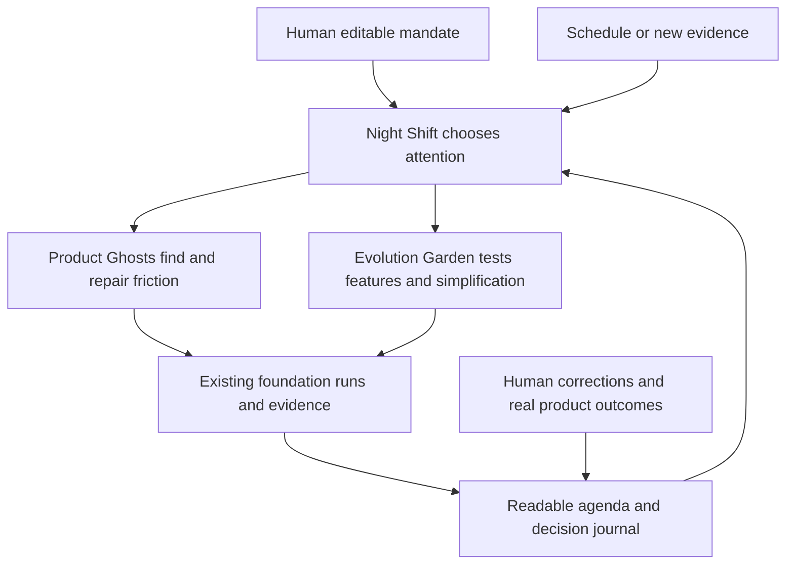

# Proactive autonomy: a harness with its own readable agenda

**Recommendation:** explore three connected features: **Night Shift**, which decides what
deserves work; **Product Ghosts**, which experiences the UI and repairs friction; and
**Evolution Garden**, which turns cleanup and feature ideas into experiments it can learn
from. Let the system take initiative and present evidence afterward. Keep its intentions,
decisions and uncertainty readable enough for a person to redirect in a minute.

This is exploratory research, not an accepted specification or an implementation. The feature
directions are deliberately open-ended, as requested. Their combinations are proposed ideas;
novelty has not been established by an exhaustive prior-art search. Research date: 2026-10-23.

## Reading map and scope

This document combines the current foundation's source and binding specification with fresh
primary-source research. Detailed external findings are in [proactive systems](autonomy-sources.md)
and [autonomous engineering](autonomous-engineering-sources.md). The appendices below record
how the three ideas were generated and what would make them fail.

The user's seeds were recurring jobs, choosing the next action without a command, finding UI
problems, cleanup, new features, analytics, and accepting more risk for a more interesting
product. The follow-up confirmed that **all of those areas** matter. Personal examples of
past failures and actual product analytics were not supplied; user-value claims remain
hypotheses. Nothing in this study establishes that a surveyed system can independently run
a successful product team.

Evidence labels used throughout:

- **Observed source:** a behavior is visible in the inspected implementation or local snapshot.
- **Documented:** a first party describes a capability; it was not exercised here.
- **Reported research:** the authors report an experiment; results were not reproduced here.
- **Hypothesis:** a proposed design or inference for this package and its host.

## What the other systems teach

| System | Primary-source finding | What to borrow |
|---|---|---|
| OpenClaw | Current source consolidates proactive work into Automations, with persistent job scratch, occurrence outcomes and quiet result handling. Some live heartbeat guidance trails source. | Keep the durable obligation and the human notification as separate things. [Migration source](https://github.com/openclaw/openclaw/blob/42c0d5a8f9d00e113c48090c3d259977e67b5b5a/docs/gateway/heartbeat.md), [detailed audit](autonomy-sources.md). |
| Paperclip | Its activity gate, routine coalescing and no-progress throttling explicitly address agents repeatedly waking themselves. Its run/issue links expose ownership. | A useful autonomy loop must recognize its own activity and avoid treating it as new demand. [Activity-gate contract](https://github.com/paperclipai/paperclip/blob/def4726bea0e3b340457100038d80ca55c2b7d4f/skills/paperclip/references/routines.md#L87), [detailed audit](autonomy-sources.md). |
| Letta Code | Its current reflection direction uses versioned memory files and separate worktrees; the older server sleep-time model is being sunset. | Prepare future context between foreground runs; retain a readable memory diff. [Reflection procedure](https://github.com/letta-ai/letta-code/blob/035bb8c8917b5dd94a3989d4adf04860a2ce8fea/src/agent/subagents/builtin/reflection-v2.md), [migration evidence](autonomy-sources.md). |
| Claude Code | An editable default maintenance order already exists; session scheduling and hosted scheduling have different lifecycles. | Differentiate on judgment. [Scheduled tasks](https://code.claude.com/docs/en/scheduled-tasks). |
| Anthropic long-running harnesses | Progress artifacts support continuity; browser evidence can locate a source handler; evaluator complexity depends on workload and model. | Persist handoffs and use the running product as evidence. [2025 experiment](https://www.anthropic.com/research/effective-harnesses-for-long-running-agents), [2026 experiment](https://www.anthropic.com/research/harness-design-long-running-apps). |
| OpenHands | SDK conversation execution and the automation service's scheduling, dispatch and history have distinct owners. | Add a host control loop around the foundation. [SDK](https://github.com/OpenHands/software-agent-sdk/blob/main/README.md), [automation](https://github.com/OpenHands/automation/blob/main/README.md). |
| Cursor Automations | Cron/event starts, persistent editable memories, browser interaction and PR creation are already documented capabilities. | A scheduled coding agent is an existing baseline. The opportunity is explaining and improving its choices. [Automations](https://cursor.com/docs/cloud-agent/automations). |
| SWE-agent / mini-swe-agent | The project now recommends its simpler successor; issue-repair benchmarks supply the problem to solve. | Keep execution small. Task selection requires additional evidence. [Current project direction](https://github.com/SWE-agent/SWE-agent/blob/main/README.md), [successor](https://github.com/SWE-agent/mini-swe-agent/blob/main/README.md). |
| OMP | The inspected snapshot persists a goal, tracks budgets, steers continuation and fingerprints tool activity to detect repeated work. | Make completion and lack of progress explicit. This is evidence of continuation, not a durable cron service. [Local goal state](../../external/omp/packages/coding-agent/src/goals/state.ts), [runtime](../../external/omp/packages/coding-agent/src/goals/runtime.ts). |
| LangGraph | Checkpointers persist thread execution state; stores persist information across threads. Replay after a checkpoint can re-execute subsequent API calls. | A saved conversation and a recoverable external action need distinct treatment. [Persistence](https://docs.langchain.com/oss/python/langgraph/persistence), [checkpointers](https://docs.langchain.com/oss/python/langgraph/checkpointers). |

**Reported research:** Agentic Harness Engineering associates edits with predictions and later
outcomes, and reports improvements on coding benchmarks. This supports investigating evidence
and decision records; it does not prove that autonomous product changes improve customer value.
The abstract is sufficient for that limited claim; this study did not reproduce its experiments
or audit the complete method. [AHE, v4, 2026-05-18](https://arxiv.org/abs/2604.25850v4).

**Reported research:** TriggerBench and ProEvent expose missed proactive actions, excessive
actions and cancellation problems in their respective memory/chat settings. These motivate
explicit future-intent records and measuring false actions; they do not predict local failure
rates. [TriggerBench](https://arxiv.org/abs/2606.23459), [ProEvent](https://arxiv.org/abs/2607.17701).

**Synthesis:** wakeups are becoming ordinary infrastructure. A more interesting system makes
three decisions well: *what deserves attention, what intervention to try, and whether the
result deserves to survive*. That is the organizing idea for the three features below.

## Current foundation and the missing loop

The package already owns much of the execution substrate. An older
[feature-gap review](feature-gap-review.md) includes a historical overview plus later landed
capabilities; its original missing-browser row should not be read as today's browser inventory.
Current source and binding pages take precedence.

| Need | What exists now | What remains |
|---|---|---|
| Readable progress | Whole-list `checklist_write` updates persisted as run events | A durable agenda and acceptance state across runs, owned by the host |
| Recovery | `runs.continuation` describes a stopped run; `continueFrom` starts a new run with the prior pins | Host scheduling, durable work identity, leases, reconciliation and a decision to continue |
| Remembering useful lessons | Opt-in lessons reflection stores general lessons through the Wiki API | A durable scouting/consolidation queue; the current lessons queue is process-local |
| Seeing a web UI | Navigation, snapshots, reading and screenshots | Mapping observed elements to their source ownership; unattended interaction against a disposable environment |
| Knowing what a run cost | Validated usage/tool/status events and trajectory reads | Host outcome aggregation and product telemetry; run usage is not customer analytics |
| Checking tool readiness | Doctor local checks and explicitly confirmed live probes | A recurring product-quality observer; Doctor itself is not an autonomous maintenance scheduler |

Source anchors: [sessions input](../../src/sessions/sessions.ts) (`:73`, `:108`),
[checklist and usage schemas](../../src/sessions/contracts.ts) (`:146`, `:180`),
[continuation](../../src/sessions/continuation.ts) (`:46`, `:96`),
[lessons queue](../../src/history/lessons.ts) (`:93`),
[browser tools](../../src/browser/tools.ts) (`:20`, `:61`, `:156`),
[Doctor contracts](../../src/doctor/types.ts) (`:27`, `:54`).

Two constraints matter before any unattended pilot:

1. **Browser interaction currently needs attendance.** `attendedOnly` in
   `src/browser/tools.ts:61` refuses page actions for unattended runs and subagents. A screenshot
   scout is available; a cron worker clicking through forms is not enabled by selecting those
   tool names. A host could supply its own isolated interaction provider through existing
   surfaces, subject to its policy. Relaxing the foundation backend would require a proposal.
2. **The unattended flag is not a complete interaction guarantee.** It configures no context-file
   discovery in `src/sessions/runner.ts:574`. However, the general gate's approval refusal is
   trigger-specific (`src/sessions/sessions.ts:198`), and `ask_user` is constructed independently
   of that flag (`:397`). The flag alone therefore does not establish `INV-RUN-5`. This static
   source finding is recorded as [known drift D-11](../architecture/README.md#known-drift);
   it was not reproduced in a live model session.

### Ownership that keeps the ideas compatible

**Foundation:** run execution, pinning, compiler, capabilities, per-call gate, run evidence,
memory APIs and generic observation tools. **Variant:** mutable c1–c8 behavior committed
through the existing validated door. **Host:** intentions, schedules, cross-run agenda, product
events, workspaces, deployment decisions and the human UI. The ownership rules are in
[00 Overview](../architecture/00-overview.md), [seven surfaces](../architecture/01-extension-points.md)
and the [family routing guide](../../../AGENTS.md).

The host can begin by supplying a mandate and current evidence through `SessionRunInput.text`
or a dynamic `launch.sections` entry, with action decisions through `ToolPolicy` and tools
through `ToolProvider`. Unattended resource discovery intentionally does not load arbitrary
project context files: the host must explicitly supply the chosen content. Changing state
continues to arrive through the prompt compiler's updates, not a rewritten system prefix.
These are proposed uses of existing surfaces, not a new eighth surface.

Keep a human-editable mandate in a **host-owned document**, not in Wiki notes masquerading as
instructions. The Wiki remains reference material under `INV-MEM-1`. Keep agenda/experiment
records outside `runs/<id>/`; the host does not become a run-record writer.

## 1. Night Shift

**Hypothesis:** give the system a standing intention, and it should come back with work worth
having done. A person writes something like “make the first successful session feel effortless”;
Night Shift decides whether today's next useful move is repairing a failed journey, finishing
an abandoned change, cleaning a recurring source of trouble, or trying a small feature.

The product feeling is a colleague who arrived early and left a useful desk note. The person
opens the application to see what the system noticed, why it chose that work, and the actual
result. The agenda stays editable: changing its direction affects future runs without needing
another conversation or erasing the old decision record.

An illustrative host document, **not a proposed parser contract**:

```markdown
# Night Shift
Direction: Make first success easier and keep this project pleasant to change.
Look for: broken journeys, repeated friction, recurring failures, useful simplifications.
Explore: one unexpected idea when evidence suggests something is missing.
Freedom: choose work and prepare working changes without a new task from me.
Deliver: a usable preview, what changed, and what still looks uncertain.
```

A scheduled or event-triggered wake checks what changed since its last meaningful decision,
selects an obligation, and runs one bounded piece of it. Its persistent agenda can distinguish
unfinished work, fresh opportunities, intentional waiting, cancelled ideas and work already
being done elsewhere. No new evidence is a valid reason to sleep. A completed run is evidence
about a turn; it does not automatically close the larger obligation.

**Why it could feel new:** the agenda is both the operating agreement and the person's control
surface. The user changes direction in ordinary prose; the system maintains a concrete view
of the next action and its evidence. Existing schedules and goal loops are ingredients. The
proposed value is how naturally a person can supervise an agent that chooses its own work.

**Safety traded for coolness:** allow the system to pick unassigned work, reinterpret priorities
within the mandate, and commit ordinary maintenance to its branch before a human reviews it.
The owner accepts wasted work and occasional misguided changes. A particularly adventurous
host could preauthorize integration of a narrow maintenance class and show an undoable receipt;
this is a future product choice, not present authorization or an implemented behavior.

**First revealing demonstration:** leave one project overnight with an unfinished obligation,
one fresh failure and stale noise. The morning result should show why one thing deserved work,
what actually changed, what was left alone, and what would trigger the next wake. Include a
restart and a cancelled obligation in the pilot; a credible system must preserve both decisions.

**Riskiest assumption:** the system can choose work the owner values. More defensible starting
point: let it select among observed failures and unfinished commitments before expanding into
new initiatives. Judge it by retained useful changes and owner corrections, not run count.

## 2. Product Ghosts

**Hypothesis:** the harness should experience the product through several believable points of
view, remember where each journey hurts, and return with a repair already demonstrated.

One ghost arrives with an empty account and no product vocabulary. Another uses only a
keyboard. Another returns to an interrupted session. These are **synthetic probes**, not
validated substitutes for real people. Their purpose is to expose plausible friction and
produce repeatable journeys, which actual usage and human reactions can later confirm.

Instead of “button looks odd,” a ghost leaves a little story: “I tried to start, reached an
empty screen, could not tell whether it was loading, and stopped.” It links the route, state,
viewport, screenshot and action sequence to the candidate component or handler. It then makes
a change and reruns the same journey. The morning artifact can put the old and new experiences
side by side, including what remains uncertain.

Knowing where to fix the UI requires a causal trail:



**Hypothesis, implementation direction:** combine browser evidence with code search, route
manifests, source maps or framework metadata where available. Those techniques suggest an
owner; they are not a universal DOM-to-source mapping. Preserve failed source-location attempts
as uncertainty instead of inventing a component address. For terminal UI, an equivalent ghost
would need a host PTY/terminal interaction surface; web browser tools do not inspect a TUI.

Source ownership matters in this repository family. A problem with a shared primitive, font,
spacing token or shell goes to the shared UI package; a page-specific behavior belongs to the
application. The ghost can learn that routing from host-supplied repository guidance. The
foundation should not contain application paths or special-case names.

**Why it could feel new:** each ghost has continuity. It remembers the point where it got stuck,
returns after a relevant change, and can say whether the product became easier to use. Pairing
that memory with a working repair makes it more useful than a scheduled screenshot report.
The underlying browser, patch and review mechanics already have precedents in the
[engineering source study](autonomous-engineering-sources.md).

**Safety traded for coolness:** permit unattended exploration and subjective presentation fixes
in a disposable app, including abandoning an existing design choice. The owner accepts taste
drift and false alarms in exchange for discovering issues nobody filed. Integration of those
patches is a separate autonomy setting; interactive exploration needs the host provider or
foundation proposal described above.

**First revealing demonstration:** give the ghosts several real journeys without telling them
where the known defects are. Compare discoveries with a maintainer's independent list. The
interesting result is one reproducible issue, a credible source owner, and a visible repair;
count invented defects and regressions as well as discoveries.

**Riskiest assumption:** synthetic frustration predicts human frustration. Start with observable
failures—clipping, unreachable controls, dead ends, lost state—and label preference judgments
as speculative. Real customer feedback must be able to overturn a ghost's opinion.

## 3. Evolution Garden

**Hypothesis:** give the system a small allowance to improve the product, and let it grow useful
features while pruning work that no longer earns its complexity. Its memory should record
which ideas failed and why, so future runs can stop rediscovering them.

This joins analytics, cleanup and feature invention in one loop. A recurring detour suggests
a shortcut; a repeated support request suggests a missing capability; a brittle duplicate
suggests simplification. The agent writes a prediction, prepares an intervention and looks for
an outcome. Sometimes its best feature idea is removing a step or consolidating two controls.

An illustrative experiment note:

```markdown
# A smaller first-run experience
Signal: People repeatedly open settings before their first successful action.
Guess: They are looking for a required choice that is hidden there.
Alternative: They may simply be exploring; the event names may also be misleading.
Bet: Put that choice beside the first action and remove the duplicate detour.
Expected result: More first attempts reach success without extra errors.
Observation: Pending real usage; the synthetic journey only confirms it can work.
Decision: Keep, revise or revert after the outcome window.
```

The example is invented, not a finding about current users. There is no inspected product
telemetry dataset in this study. The host would need event definitions, feedback, release
identity and outcomes. Run cost and tool failures can guide engineering maintenance today;
they cannot establish that customers need a new feature. Observational changes alone do not
prove causality, and missing telemetry is uncertainty rather than a zero.

Cleanup gets the same treatment. “No imports found” is a lead, not proof of dead code: public
exports, plugins, dynamic loading and generated entry points can matter. The agent can propose
a removal and demonstrate the behavior it checked. Low feature usage alone is also insufficient
evidence for deletion. The interesting power is being willing to simplify the product when
several forms of evidence agree.

**Why it could feel new:** the system develops an explicit, revisable taste for what deserves
to survive. Its decision journal can say “I tried this, it did not help, and here is what would
make it worth revisiting.” A removed idea remains discoverable; a person can revive it with
new evidence. The proposed journal borrows the prediction/outcome idea discussed in
[AHE](https://arxiv.org/abs/2604.25850v4), but customer-value optimization remains unverified.

**Safety traded for coolness:** let the system invent and implement small experiments, prune
ordinary code and revise its own priority ordering without a task-by-task instruction. A
future host could additionally allow a limited rollout and automatic rollback. The owner
accepts temporary regressions and failed bets in exchange for continuous product exploration.
Undo should include configuration and rollout state: reverting a commit does not reverse a
customer action or every data effect.

**First revealing demonstration:** take a project with existing friction evidence, prepare one
new capability and one simplification, and state what would justify keeping either. Release
measurement comes only when the host has real telemetry and an authorized rollout mechanism;
without those, the honest output is a working preview with an untested value hypothesis.

**Riskiest assumption:** observed signals identify a valuable intervention. Require competing
explanations and retain rejected predictions. Do not reward the agent for generating more
ideas, deleting more lines or increasing its own activity.

## How they fit together



This is a conceptual flow, not new internal modules. Start with Night Shift's durable agenda,
use Product Ghosts for concrete evidence, then let Evolution Garden widen the initiative.
The first version could live largely in a host using today's execution surfaces. A generic
reusable host package might become worthwhile after a second consumer demonstrates the seam;
moving schedules into the foundation is not required to explore these ideas.

### Where to spend the risk

The useful trade is **fewer approvals over work selection and ordinary reversible changes**,
plus more freedom to make subjective bets. Readable evidence and an undo path make that freedom
usable; neither guarantees the changes are correct. Keep the risk attached to a visible product
setting: choose work, prepare patches, integrate selected change classes, or run experiments.
An ambiguous sentence in a memory note should not silently expand the action setting.

The existing refinement method remains a different mechanism. Its probes do not act in the
world, its evidence stays answer-free, and adoption is a person's action
(`INV-REF-1`, `INV-REF-4`, `INV-REF-6`). Product-outcome experiments should initially use ordinary
runs and host records. Automatically adopting variants, feeding grader results into current
refinement, or editing foundation code from an improver would require explicit architecture
changes, not a reinterpretation of the word “automatic.”

### What would make the autonomy credible

These are **proposed evaluation questions**, not measured results or new benchmark tasks:

| Question | Evidence to inspect |
|---|---|
| Does it choose worthwhile work? | Changes retained by the owner; corrected priorities; false starts and rejected work |
| Does it know when to stop? | Repeated-work rate, intentional idle decisions, cancellations honored, stale suggestions suppressed |
| Does it repair the experienced problem? | Same journey before and after; correct source ownership; neighboring behavior and regressions |
| Does it improve something people value? | Defined product outcome, observation window, competing explanations and a defensible comparison |
| Is autonomy affordable? | Whole-obligation cost including scouting, critics, retries, reflection and abandoned experiments |
| Is it readable? | Whether a person can find the chosen action, reason, evidence, uncertainty and undo path without reading a transcript |

The scheduler should plan for at-least-once delivery and reconciliation of uncertain actions.
Durable occurrence IDs and worker leases prevent many duplicates; an external side effect
still needs an idempotency key or an explicit check of whether it happened. A normal “complete”
run event proves the run ended; product acceptance and keeping an experiment are host decisions.
This is design reasoning, not an exactly-once guarantee from the existing foundation.

## Appendix: idea generation and selection

**Frame:** move from a person assigning tasks to a system proposing and performing useful work
under an editable direction. Include people who have not adopted the product and the person who
must judge its output, not only the developer watching a terminal.

The following capability/context matrix is exploratory. All 30 cells are unvalidated raw
ideas, not additional recommended features. “Seed” identifies a direct extension of the user's
requested capabilities.

| Context | Choose attention | Experience a journey | Locate and change source | Remember across runs | Compare outcomes |
|---|---|---|---|---|---|
| Developer returning tomorrow | Prepare tomorrow's best next action (seed) | Replay yesterday's failed path | Finish the smallest abandoned patch | Preserve why other work was deferred | Show useful work retained after review |
| Maintainer away for a week | Select recurring failures before cosmetics (seed) | Revisit recently changed routes | Consolidate a duplicate at its owner (seed) | Remember what should never be auto-cleaned | Compare regressions and maintenance churn |
| First-time visitor who has not adopted | Find the first unexplained decision | Navigate with an empty account (seed) | Add a contextual hint beside the blockage | Keep an evolving first-visit story | Compare first success with prior behavior |
| Former user who abandoned the product | Revisit the reason they left | Return to an interrupted journey | Prepare a reduced version of a complex flow | Retain rejected assumptions about that user | Seek evidence that the original obstacle changed |
| Accessibility reviewer judging the output | Select inaccessible journeys | Complete a keyboard-only route | Fix shared focus behavior at its source | Retain an interaction ledger with uncertainty | Compare reachability and task success |
| Product owner looking for direction | Choose one unexplained usage pattern (seed) | Experience the suspected detour | Prepare a feature or remove a step (seed) | Keep a graveyard of disproved ideas | Compare an explicit prediction with an outcome (seed) |

Five obvious answers were transformed: a cron wrapper became a readable standing mandate;
a screenshot monitor became a remembering user journey; an automated linter became
evidence-based simplification; a feature suggestion box became a working experiment; a token
dashboard became a journal of cost versus retained outcomes.

The divergence lenses were **inversion** (the system acts and the person steers), **timing**
(new evidence earns a wake), **a garden analogy** (prune as well as grow), **extreme users**
(empty-account and keyboard-only journeys), and **removing the per-task instruction constraint**
(choose a useful obligation from direction). Six promising threads—readable mandate, durable
agenda, remembering journeys, source ownership, simplification and product bets—were merged
into the three recommended concepts.

The editorial scores below are judgments on a 1–5 scale, not measurements. Feasibility means
a focused local pilot; the user supplied no delivery deadline. Novelty rates the proposed
combination, not a claim to have invented its ingredients.

| Concept | Novelty | Pain addressed | Fit with this foundation | Pilot feasibility | Ease of getting evidence |
|---|---:|---:|---:|---:|---:|
| Night Shift | 3 | 5 | 5 | 4 | 4 |
| Product Ghosts | 4 | 4 | 4 | 3 | 4 |
| Evolution Garden | 4 | 4 | 3 | 2 | 2 |

## Research limits and source trace

Local source inspection used the working tree, which already contained unrelated terminal and
browser edits. No product code, cron jobs, permissions, model requests or deployments were
changed. The OMP comparison is pinned to local commit
`63a7ba5dcc74cca2cb0ecb710770eb756102035d`; key anchors are
`goals/runtime.ts:8`, `goals/state.ts:23` and `:50`, plus its
[continuation instruction](../../external/omp/packages/coding-agent/src/prompts/goals/goal-continuation.md).
It is a snapshot, not a claim about the latest upstream release.

The companion studies give external source identities, inspected portions, changed behavior
versus older guidance, and the limits of reported experiments. Live documentation can change;
versioned source has priority where those disagree. This study did not run surveyed products,
measure customer outcomes or prove general reliability. The first decision is whether the
three directions are desirable; formal proposals and implementation should follow concrete
pilots and the repository's architecture process.
